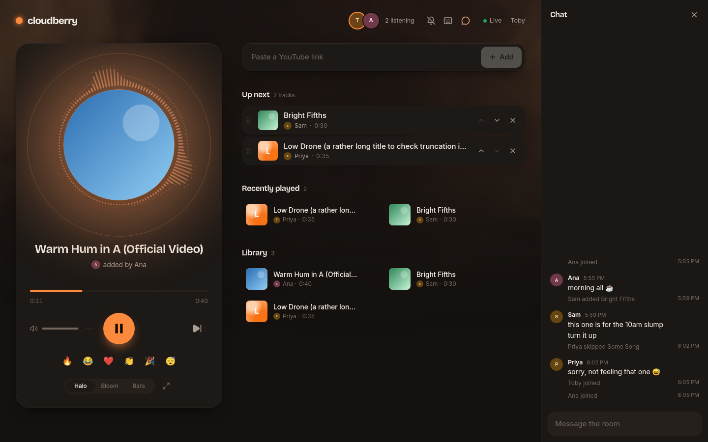
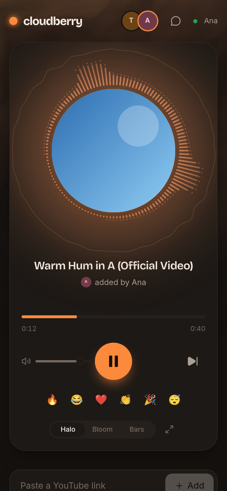
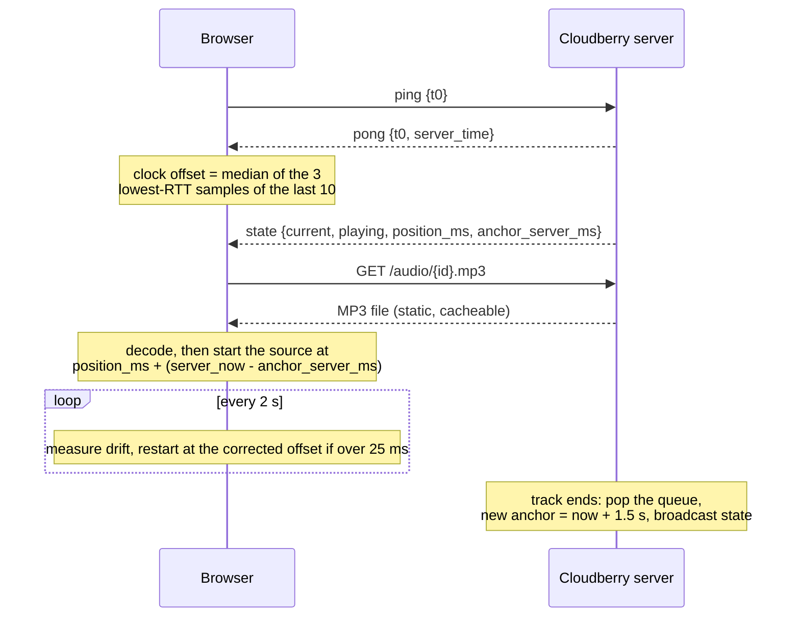

<div align="center">


# Cloudberry

**A tiny self-hosted shared radio. Everyone who tunes in hears the same track at the same moment.**

[](LICENSE)
[](crates/server)
[](web)
[](docs/architecture.md#wasm-modules)
[](docs/deploy.md)


&nbsp;


</div>

## What it is

Cloudberry is one shared station for a handful of friends or coworkers on a private network.
Paste a YouTube link, the server downloads it, and anyone can queue, skip, reorder or pause.
The server never streams audio: it keeps a shared clock, and every browser schedules the same
file to land on the same timeline.

## Highlights

- **In sync, not streamed.** Clients fetch the MP3 and start it on a shared server timeline,
  correcting drift above 25 ms.
- **Paste to play.** YouTube links (also pasted anywhere on the page) are downloaded with
  yt-dlp and loudness-normalised to -14 LUFS.
- **Everyone is the DJ.** Play/pause, skip, seek, drag-to-reorder, remove, with undo for skip and remove.
- **Social.** Side chat with action events, emoji reactions floating over the art, listener
  avatars, synced lyrics from LRCLIB when available.
- **Visualizer.** Rust→WASM spectrum, band and beat analysis driving three modes (Halo, Bloom,
  Bars) and a fullscreen lean-back view (`F`).
- **Fits in a browser tab.** Media Session controls, tab title, keyboard shortcuts
  (`Space`, `N`, `/`, `?`, `F`), per-track tint, light and dark mode, `prefers-reduced-motion`.
- **Tiny.** One Rust binary plus SQLite; target under 40 MB RSS when idle.

## How the sync works

The server only owns state: what is playing, from which position, anchored at which server time.
Each browser estimates the server clock over the WebSocket and does the rest locally.



Full details: [docs/architecture.md](docs/architecture.md#sync-algorithm).

## Quick start

### Docker Compose / Dockge (builds from source)

```sh
git clone https://github.com/Toby-Faucher/cloudberry.git /opt/stacks/cloudberry
cd /opt/stacks/cloudberry
docker compose up -d --build        # or press Deploy on the stack in Dockge
```

Open <http://localhost:8080>. Change the host port with `CLOUDBERRY_PORT` (for example in a
`.env` file next to `compose.yaml`). Music and the SQLite database live in `./data`.

### Prebuilt deploy for small hosts

If the server is too small to compile Rust, build locally and ship only the runtime image:

```sh
scripts/deploy.sh <ssh-host> <port>   # e.g. scripts/deploy.sh 10.0.0.163 2279
```

Needs `cargo-zigbuild` + `zig`, `npm`, the `wasm32-unknown-unknown` target, and SSH access to a
Docker host. See [docs/deploy.md](docs/deploy.md) for volumes, updating yt-dlp, backups and
troubleshooting.

## Configuration

All read by the server at startup.

| Variable | Default (bare binary) | Default (Docker image) | Meaning |
|---|---|---|---|
| `CLOUDBERRY_MUSIC_DIR` | `./data/music` | `/data/music` | Where `{id}.mp3` and `{id}.jpg` are stored |
| `CLOUDBERRY_DB_PATH` | `./data/cloudberry.db` | `/data/cloudberry.db` | SQLite file |
| `CLOUDBERRY_BIND` | `0.0.0.0:8080` | `0.0.0.0:8080` | Listen address |
| `CLOUDBERRY_STATIC_DIR` | `./web/build` | `/app/web/build` | Built SvelteKit site |
| `CLOUDBERRY_YTDLP` | `yt-dlp` | `yt-dlp` | yt-dlp executable |
| `TZ` | system zone | `UTC` (compose sets `America/New_York`) | Day boundary for DJ of the day |
| `CLOUDBERRY_PORT` | n/a | `8080` | Compose only: host port mapped to the container |

## Local development

```sh
./scripts/build-wasm.sh              # visualizer.wasm + smear.wasm -> web/static/
cargo run -p server                  # API + WebSocket on :8080, data in ./data
cd web && npm install && npm run dev # Vite on :5173, proxies /api /ws /audio /art to :8080
```

No Rust toolchain handy? `cd web && node scripts/mock-server.mjs` stands in for the server on
:8080 with generated tones. Setup, tests and style: [CONTRIBUTING.md](CONTRIBUTING.md).

## Project layout

```
crates/server/       axum binary "cloudberry": station state, WebSocket, downloads, SQLite
crates/visualizer/   cdylib -> visualizer.wasm: FFT bars, bands, beat detection, waveform
crates/smear/        cdylib -> smear.wasm: smear-motion physics and berry-rain particles
web/                 SvelteKit SPA (Svelte 5, adapter-static) served by the server
web/scripts/         mock-server.mjs for UI work without cargo
scripts/             build-wasm.sh, deploy.sh, screenshots.mjs
deploy/              Dockerfile.prebuilt for scripts/deploy.sh
docs/                architecture, deploy guide, design spec
```

## Tech stack

Rust 2024 (axum 0.8, tokio, rusqlite with bundled SQLite) · SvelteKit + Svelte 5 · Bits UI ·
plain CSS tokens · `realfft` compiled to `wasm32-unknown-unknown` without wasm-bindgen ·
yt-dlp + ffmpeg (+ deno for YouTube challenges) · Docker on `debian:bookworm-slim`.

## Roadmap / in progress

Spec'd in the [design doc](docs/superpowers/specs/2026-11-07-cloudberry-design.md), not done yet:

- **Game-feel UI pass:** cloudberry amber (`#F0912B`) tokens, bolder HUD-style layout, anime.js
  motion throughout.
- **Smear motion in the UI:** the WASM engine and JS bridge exist (`crates/smear`,
  `web/src/lib/motion/smear.ts`) but are not wired into components yet.
- **The ten quirks:** hold to skip, title card, reaction combos, DJ-of-the-day crown, sync
  readout, poke, away state, up-next countdown, Konami berry rain. The server already speaks
  poke, presence and DJ of the day (UI pending), and auto-pause when everyone leaves already works.
- **Later:** Spotify links via "match by name, fetch from YouTube" (no Spotify audio, DRM).

## License

[MIT](LICENSE) © 2026 Toby Faucher
