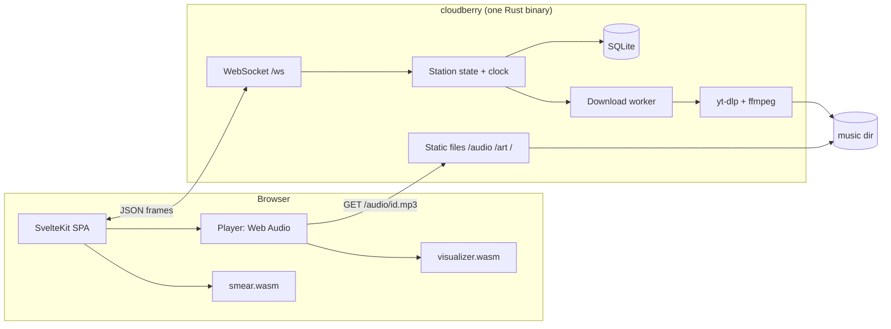

# Architecture

The source of truth for the protocol and behaviour is the
[design spec](superpowers/specs/2026-11-07-cloudberry-design.md). This page is the map.

## Components



| Part | Where | Role |
|---|---|---|
| Server | [`crates/server`](../crates/server) | axum on a single-threaded tokio runtime. Owns station state, the clock, the queue, chat and downloads. Serves the built SPA with an `index.html` fallback. |
| Visualizer | [`crates/visualizer`](../crates/visualizer) | Audio analysis compiled to WASM, fed from an `AnalyserNode`. |
| Smear | [`crates/smear`](../crates/smear) | Motion physics for smear frames and berry-rain particles, compiled to WASM. |
| Web | [`web`](../web) | SvelteKit (adapter-static) SPA, Svelte 5 runes, Bits UI, plain CSS tokens. |

HTTP surface: `GET /api/state`, `GET /ws?name=<1-32 chars>`, `GET /audio/{id}.mp3`,
`GET /art/{id}.jpg` (only 11-char video ids, `Cache-Control: immutable`), everything else the SPA.

## WebSocket protocol

JSON text frames tagged by `type`; max frame 64 KB. Full shapes in the
[spec](superpowers/specs/2026-11-07-cloudberry-design.md#websocket-protocol-json-text-frames-tagged-by-type).

| Direction | Messages |
|---|---|
| Client → server | `ping`, `add`, `enqueue`, `insert`, `remove`, `move`, `play`, `pause`, `skip`, `seek`, `chat`, `react`, `poke`, `presence` |
| Server → client | `welcome`, `chat_history`, `pong`, `state`, `job`, `chat`, `react`, `poke`, `error` |

`state` carries the whole `StationState` (current, queue, playing, position/anchor, listeners
with `away`, library, history, jobs, `dj_of_day`) and is re-sent after every change. Per-connection
rate limits: chat 5 per 5 s, react 10 per 5 s, poke 1 per 2 s; excess is dropped.

## Sync algorithm

The server never streams audio. It stores an anchor: `position_ms` was the playback position at
server time `anchor_server_ms`. While playing, live position = `position_ms + (server_now - anchor_server_ms)`.

**Server** ([`station.rs`](../crates/server/src/station.rs))
- A tokio timer fires at the current track's end, pops the queue and sets the anchor to
  `now + 1500 ms` so every client has time to decode the next file (clients prefetch it).
- Play and seek re-anchor at `now + 300 ms`; pause freezes the live position.
- The last listener disconnecting pauses the station. On shutdown the live position is saved,
  so a restart resumes paused at the same spot.

**Client** ([`web/src/lib/sync.ts`](../web/src/lib/sync.ts))
1. Clock: NTP-style ping/pong; offset = median of the 3 lowest-RTT samples among the last 10.
2. Fetch and `decodeAudioData` the MP3, then `AudioBufferSourceNode.start(when, offset)` so it
   lands on the shared timeline.
3. AudioContext time is mapped to wall time with `getOutputTimestamp()`, and `outputLatency`
   (or `baseLatency`) is subtracted so Bluetooth output still lines up.
4. Every 2 s the player measures drift; above 25 ms it restarts the source at the corrected offset.
5. Per-track `gain_db` is applied on a `GainNode`.

## Download pipeline

[`ytdl.rs`](../crates/server/src/ytdl.rs), [`loudness.rs`](../crates/server/src/loudness.rs)

1. `add` URL → host must be `youtube.com`, `www.`/`m.`/`music.youtube.com` or `youtu.be`;
   extract the 11-char id. Anything else → `error`.
2. Already in the library → enqueue immediately, no download.
3. Otherwise a `Job` goes onto an mpsc channel; one worker downloads one track at a time.
4. yt-dlp runs on a canonical URL rebuilt from the id (never user strings), `--no-playlist`,
   `--match-filter duration<=1200` (20 min cap), MP3 at quality 2, JPG thumbnail, a machine-readable
   progress template streamed to clients as `job` messages.
5. After download, one ffmpeg `ebur128` pass → `gain_db = clamp(-14 - I, -12, 12)`. Tracks without
   a measurement are backfilled one at a time at startup.
6. Track added to the library and the queue; a chat event is posted.

## Persistence

SQLite (rusqlite, bundled, WAL mode) at `CLOUDBERRY_DB_PATH`; media files in `CLOUDBERRY_MUSIC_DIR`.

| Table | Contents |
|---|---|
| `tracks` | library: id, title, duration, thumbnail flag, added_by/at, `gain_db` |
| `queue` | upcoming items with position |
| `station` | key/value: current item, position, so restarts resume |
| `chat` | user messages and action events, last 500 kept (last 100 sent on connect) |
| `history` | recently played (last 20 exposed) |
| `reactions` | per local day and name: count + last time, for DJ of the day |

"Day" is the server's local day via SQLite `localtime`, so set `TZ`.

## WASM modules

Both are `cdylib` crates built for `wasm32-unknown-unknown` with no wasm-bindgen and no imports:
plain `extern "C"` functions over static buffers that JS reads through `memory`. Each has a JS
fallback if the module fails to load, and a raw-ABI smoke test in `scripts/smoke.mjs`.

### `visualizer.wasm`

```
FFT_SIZE = 2048, BARS = 64, WAVE_POINTS = 256
input_ptr()    -> *mut f32    // JS writes FFT_SIZE time-domain samples (-1..1)
process(sample_rate: f32, dt_seconds: f32)
output_ptr()   -> *const f32  // BARS values 0..1, log-spaced 30 Hz-16 kHz, smoothed
peaks_ptr()    -> *const f32  // BARS falling peak-hold values
energy()       -> f32         // overall loudness 0..1
bass() / mid() / treble() -> f32   // smoothed bands 0..1
beat()         -> f32         // 1.0 on an onset, decays over ~250 ms
waveform_ptr() -> *const f32  // WAVE_POINTS downsampled samples
```

Hann window + real FFT (`realfft`), -90..-10 dB mapped to 0..1, attack/decay smoothing, beat
detection by spectral flux with an adaptive threshold. One rAF loop
([`analysis.ts`](../web/src/lib/visualizer/analysis.ts)) calls `process` once per frame and feeds
Halo (Canvas 2D ring), Bloom (WebGL2 shader, CSS fallback) and Bars, plus the backdrop and lean-back.

### `smear.wasm`

```
MAX_BODIES = 256, MAX_RAIN = 256
bodies_ptr() -> *mut f32     // JS writes [x, y] per body each frame
step(n_bodies: u32, dt: f32)
smear_ptr()  -> *const f32   // per body [stretch, angle, blur, speed]
reset(i: u32)
rain_spawn(count: u32, width: f32, seed: u32)
rain_step(dt: f32, width: f32, height: f32) -> u32   // live particle count
rain_ptr()   -> *const f32   // per particle [x, y, vx, vy, rot, size, life]
```

Bridge: [`web/src/lib/motion/smear.ts`](../web/src/lib/motion/smear.ts). Not yet used by
components (see the roadmap in the [README](../README.md#roadmap--in-progress)).

## Memory budget

- Target: under 40 MB RSS for the idle server (spec goal). The server holds only metadata; audio
  is served as static files and decoded in browsers.
- Single-threaded tokio runtime, one download at a time, small dependency set.
- Downloads are the peak: yt-dlp plus ffmpeg transcoding can briefly use far more than the server
  itself, which is why `compose.yaml` sets `mem_limit: 512m` rather than something tighter.
- Browser side: only the current and next decoded buffers are kept; visualizer loops pause while
  the tab is hidden and cap DPR at 2.
